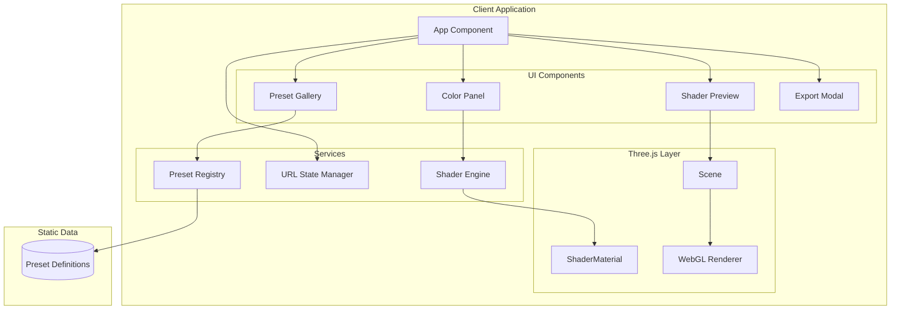

# Design Document: Shader Preset Explorer

## Overview

A web application that lets users browse pre-built GLSL shader effects and customize colors via color pickers. Built with React, Three.js for rendering, and vanilla CSS for styling. No backend required - all presets are bundled as static data.

The design prioritizes:
- Instant visual feedback when changing colors
- Simple, non-technical user interface
- Easy export for use in other projects
- Consistent with existing GLSL steering file conventions

## Architecture



### Technology Stack

- **UI Framework**: React 18 with TypeScript
- **Shader Rendering**: Three.js with ShaderMaterial
- **Color Picker**: react-colorful (lightweight, accessible)
- **Styling**: CSS Modules
- **Build Tool**: Vite
- **State Management**: React useState + URL params

## Components and Interfaces

### Core Components

#### App Component
Root component managing global state and layout.

```typescript
interface AppState {
  selectedPresetId: string;
  customColors: Record<string, string>; // colorKey -> hex value
  isExportOpen: boolean;
  categoryFilter: string | null;
}
```

#### PresetGallery
Grid of preset thumbnails with category filtering.

```typescript
interface PresetGalleryProps {
  presets: Preset[];
  selectedId: string;
  categoryFilter: string | null;
  onSelect: (presetId: string) => void;
  onCategoryChange: (category: string | null) => void;
}
```

#### ShaderPreview
Three.js canvas rendering the active shader.

```typescript
interface ShaderPreviewProps {
  preset: Preset;
  colors: Record<string, string>;
  onError: (error: string | null) => void;
}
```

#### ColorPanel
Color pickers for the active preset's customizable colors.

```typescript
interface ColorPanelProps {
  colorDefinitions: ColorDefinition[];
  values: Record<string, string>;
  onChange: (colorKey: string, value: string) => void;
  onReset: () => void;
}

interface ColorDefinition {
  key: string;
  label: string;
  defaultValue: string;
  description?: string;
}
```

#### ExportModal
Modal for exporting shader code.

```typescript
interface ExportModalProps {
  preset: Preset;
  colors: Record<string, string>;
  onClose: () => void;
}
```

### Services

#### ShaderEngine
Compiles shaders and manages Three.js material.

```typescript
interface ShaderEngine {
  createMaterial(fragmentShader: string, colors: Record<string, string>): THREE.ShaderMaterial;
  updateColors(material: THREE.ShaderMaterial, colors: Record<string, string>): void;
  generateExportCode(preset: Preset, colors: Record<string, string>): string;
}
```

#### PresetRegistry
Manages preset definitions and lookup.

```typescript
interface PresetRegistry {
  getAll(): Preset[];
  getById(id: string): Preset | undefined;
  getByCategory(category: string): Preset[];
  getCategories(): string[];
}
```

#### URLStateManager
Syncs app state with URL parameters.

```typescript
interface URLStateManager {
  getStateFromURL(): { presetId: string; colors: Record<string, string> } | null;
  updateURL(presetId: string, colors: Record<string, string>): void;
}
```

## Data Models

### Preset Definition

```typescript
interface Preset {
  id: string;
  name: string;
  description: string;
  category: 'abstract' | 'nature' | 'geometric' | 'animated';
  thumbnail?: string; // Optional static thumbnail, otherwise render live
  colors: ColorDefinition[];
  fragmentShader: string; // GLSL code with {{colorKey}} placeholders
}

interface ColorDefinition {
  key: string;
  label: string;
  defaultValue: string; // Hex color
  description?: string;
}
```

### Example Preset

```typescript
const auroraPreset: Preset = {
  id: 'aurora',
  name: 'Aurora Borealis',
  description: 'Flowing northern lights effect with customizable glow colors',
  category: 'nature',
  colors: [
    { key: 'primary', label: 'Primary Glow', defaultValue: '#00ff88', description: 'Main aurora color' },
    { key: 'secondary', label: 'Secondary Glow', defaultValue: '#0088ff', description: 'Accent color' },
    { key: 'background', label: 'Sky Color', defaultValue: '#0a0a20', description: 'Background gradient' },
  ],
  fragmentShader: `
    precision mediump float;
    uniform float u_time;
    uniform vec2 u_mouse;
    uniform vec2 u_resolution;
    uniform vec3 u_primary;
    uniform vec3 u_secondary;
    uniform vec3 u_background;
    varying vec2 v_uv;

    // ... shader implementation using u_primary, u_secondary, u_background
  `
};
```

### Shader Uniforms (matching steering file)

```typescript
interface ShaderUniforms {
  u_time: { value: number };
  u_mouse: { value: THREE.Vector2 };
  u_resolution: { value: THREE.Vector2 };
  // Dynamic color uniforms added per preset
  [colorKey: string]: { value: THREE.Vector3 | number | THREE.Vector2 };
}

const VERTEX_SHADER = `
  varying vec2 v_uv;
  void main() {
    v_uv = uv;
    gl_Position = projectionMatrix * modelViewMatrix * vec4(position, 1.0);
  }
`;
```

### URL State Format

```
?preset=aurora&primary=00ff88&secondary=0088ff&background=0a0a20
```

## Preset Library (Initial Set)

### Abstract Category
1. **Plasma** - Classic plasma effect with swirling colors
2. **Gradient Flow** - Animated gradient transitions
3. **Noise Field** - Perlin noise visualization

### Nature Category
4. **Aurora** - Northern lights effect
5. **Ocean Waves** - Rippling water surface
6. **Fire** - Flame/fire effect
7. **Sunset** - Gradient sky with sun glow

### Geometric Category
8. **Grid Pulse** - Pulsing grid lines
9. **Circles** - Concentric animated circles
10. **Voronoi** - Voronoi cell pattern

### Animated Category
11. **Starfield** - Twinkling stars with parallax
12. **Matrix Rain** - Digital rain effect
13. **Pulse** - Radial pulse from center

## Correctness Properties

### Property 1: Color Change Updates Preview

*For any* preset and color value change, the ShaderPreview SHALL re-render with the new color within 100ms.

**Validates: Requirements 3.2**

### Property 2: URL State Round-Trip

*For any* preset ID and color configuration, encoding to URL and decoding back SHALL produce identical values.

**Validates: Requirements 7.1, 7.2**

### Property 3: Preset Colors Have Defaults

*For any* preset in the registry, each ColorDefinition SHALL have a valid hex color as defaultValue.

**Validates: Requirements 3.5, 8.2**

### Property 4: Export Contains All Uniforms

*For any* preset and color configuration, the exported code SHALL include u_time, u_mouse, u_resolution, and all color uniforms.

**Validates: Requirements 5.1, 5.4**

### Property 5: Category Filter Shows Correct Presets

*For any* category filter, the gallery SHALL display exactly the presets where preset.category matches the filter.

**Validates: Requirements 4.2**

### Property 6: Hex Color Parsing

*For any* valid 6-character hex string, parsing to RGB and back to hex SHALL produce the same value (case-insensitive).

**Validates: Requirements 3.3**

### Property 7: Mouse Position Normalization

*For any* mouse position within canvas bounds, the u_mouse uniform SHALL be in range [0, 1] for both components.

**Validates: Requirements 2.3**

### Property 8: Reset Restores Defaults

*For any* preset with modified colors, clicking reset SHALL restore all colors to their defaultValue.

**Validates: Requirements 3.5**

## Error Handling

### Shader Compilation Errors
- Display fallback gradient (preset's background color)
- Show subtle error indicator (red border on preview)
- Log error to console for debugging

### Invalid URL Parameters
- Ignore invalid preset IDs, use first preset
- Ignore invalid color values, use defaults
- Don't crash on malformed URLs

### WebGL Not Supported
- Display static fallback image
- Show message suggesting browser upgrade

## Testing Strategy

### Unit Tests
- URL encoding/decoding
- Hex color parsing and conversion
- Preset registry lookups
- Export code generation

### Property-Based Tests
- Color round-trip (hex → RGB → hex)
- URL state round-trip
- Category filtering correctness

### Integration Tests
- Full flow: select preset → change colors → export
- URL sharing: generate URL → load URL → verify state

### Manual Testing
- Visual quality of each preset
- Color picker usability
- Mobile responsiveness
- Export code works in standalone HTML
